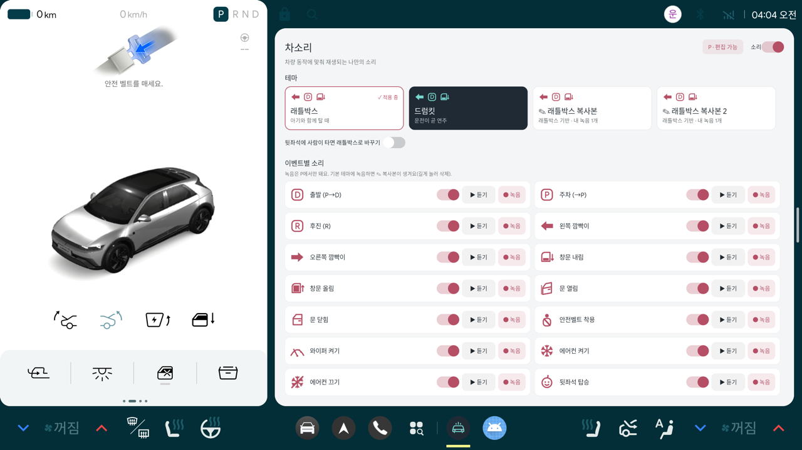
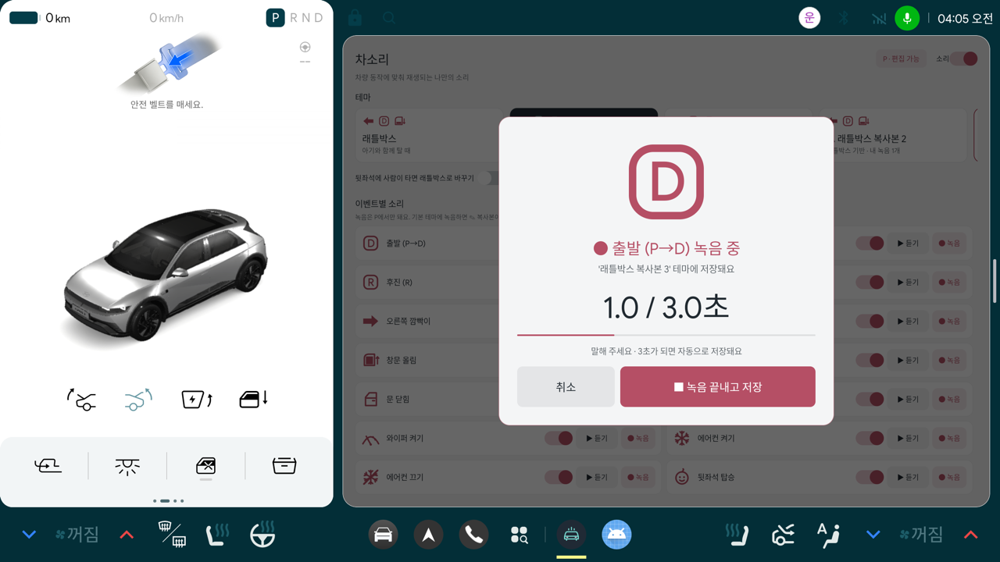

# 차소리 (가칭)

깜빡이·창문·기어 같은 차량 동작마다, 고른 테마 소리나 가족이 녹음한 목소리를 들려주는 Pleos Connect(Android Automotive)용 앱입니다.
서버·계정·휴대폰 앱 없이 차 안에서만 동작합니다.

| 설정 화면 | 녹음 창 |
|---|---|
|  |  |

## 기능

- 차량 이벤트 14종에 소리 연결: 출발(P→D), 주차, 후진, 깜빡이 좌·우, 창문 내림·올림, 문 열림·닫힘, 안전벨트, 와이퍼, 에어컨 켜기·끄기, 뒷좌석 탑승
- 기본 테마 2종(래틀박스, 드럼킷). 기본 테마는 읽기 전용
- 내 목소리 녹음(최대 3초, 기어 P에서만). 기본 테마에서 녹음하면 복사본 테마가 생기고 녹음은 복사본에 저장
- 이벤트별 켜고 끄기, 전체 켜고 끄기
- 주행 중에는 화면 대신 소리와 알림 띠(내비 위 2.5~4초, 깜빡이는 켜져 있는 동안 소리를 되풀이하며 유지, 터치를 받지 않음)
- 순정 경고음은 건드리지 않고 그 위에 1.5초 이내의 소리만 덧붙임

## 빌드와 설치

- 필요한 것: JDK 17, Android SDK 34, Pleos Connect 에뮬레이터(v2.1.0)
- Pleos Vehicle SDK 2.3.2(`ai.pleos.playground:Vehicle`)를 씁니다.

```bash
./gradlew assembleDebug
adb install -r app/build/outputs/apk/debug/app-debug.apk
```

제출용 빌드는 `./gradlew assembleRelease`로 만듭니다(기본 디버그 키로 서명).
빌드된 파일은 [release/carsound-v0.1.apk](release/carsound-v0.1.apk)에 있습니다.

## 폴더 구조

```
app/src/main/
├─ assets/themes/<테마>/        기본 테마: theme.json(이름·색·움직임) + <이벤트키>_<번호>.wav
└─ java/kr/carsound/app/
   ├─ CarSoundApp.kt            부품을 만들고 서로 연결(이벤트 → 소리 → 알림 띠)
   ├─ core/                     차량 이벤트·아이콘 종류·기어 정의
   ├─ vehicle/                  Vehicle SDK 리스너 등록, 값의 "변화"만 이벤트로 바꾸기
   ├─ sound/                    소리 미리 불러오기와 재생(변형 고르기, 좌우 음량, 몰림 방지)
   ├─ theme/                    기본 테마 읽기, 내 테마(복사본) 저장
   ├─ record/                   녹음, 녹음 파일 보관, P단 잠금
   ├─ settings/                 사용자 설정(테마, 켜고 끄기)
   ├─ overlay/                  주행 중 내비 위 알림 띠
   ├─ glyph/                    이벤트 아이콘 그리기(화면과 알림 띠가 함께 씀)
   ├─ service/                  백그라운드에서 앱을 살려 두는 서비스
   └─ ui/                       정차 중 설정 화면
      ├─ MainActivity.kt        눌렀을 때의 동작과 상태 반영
      ├─ MainLayout.kt          화면 배치
      ├─ EventTileView.kt       이벤트 한 칸(스위치·듣기·녹음)
      ├─ ThemeCardView.kt       테마 카드
      ├─ CenterStage.kt         가운데 큰 아이콘(재생 중, 켬·끔 표시)
      ├─ RecordLayer.kt         녹음 창
      ├─ ConfirmDialog.kt       삭제 확인 대화상자
      └─ Ui.kt                  공용 도우미
tools/
├─ build_themes.py              원본 녹음에서 테마 소리를 만들고 길이·음량을 맞춤
├─ demo/car.sh                  에뮬레이터 차량 시뮬레이터에 값 보내기(시연용)
└─ video/                       시연 영상 촬영·편집 스크립트
docs/                           README에 쓰는 화면 캡처
release/                        빌드된 APK
SOUND_SOURCES.md                소리 출처와 라이선스
```

## 시연 방법

에뮬레이터 안의 "Pleos Connect Virtual Console"로 차량 값을 바꾸면 실제 Vehicle SDK 이벤트가 앱에 들어옵니다.

```bash
adb forward tcp:18088 tcp:8088
tools/demo/car.sh keepalive &
tools/demo/car.sh gear D
tools/demo/car.sh turn left
```

## 알려진 한계

- 에뮬레이터는 마이크 입력이 무음이라 실제 목소리 녹음 품질은 확인하지 못했습니다.
- 실제 차량에서는 이벤트 형식과 지연이 에뮬레이터와 다를 수 있습니다.
- 알림 띠는 "다른 앱 위에 표시" 권한이 필요하고, 권한이 없으면 소리만 냅니다.
- 화면 글자는 코드에 직접 들어 있습니다(다국어 리소스 분리는 하지 않음).

## 소리 출처

기본 테마 소리는 CC0(퍼블릭 도메인) 녹음 또는 직접 만든 합성음입니다. 자세한 내용은 [SOUND_SOURCES.md](SOUND_SOURCES.md)에 있습니다.
